# מדריך למשתמש – GemachHub

GemachHub היא מערכת לרשת גמ"חים קהילתית להשאלת ציוד: שולחנות וכיסאות לאירועים, ציוד לתינוקות, הגברה וציוד רפואי.
המדריך מסביר איך משתמשים במערכת, לפי סוג המשתמש: **שואל**, **תורם**, **מתנדב בנקודה** ו**מנהל רשת**.

**איך נכנסים:** אחרי הרצת המערכת (ראו [README](../README.md)) פותחים בדפדפן את http://localhost:5173.
בראש כל דף יש תפריט עם כל הדפים: קטלוג ונקודות, העגלה שלי, ההשאלות שלי, מלאי נקודה, עמדת מתנדב, השאלות באיחור, ניהול רשת.
המערכת מותאמת גם לטלפון.

> אין במערכת סיסמאות. השואל והתורם מזוהים לפי מספר הטלפון שלהם, והמספר נשמר בדפדפן לכניסה הבאה.

---

## חלק א: שואלים

### 1. חיפוש ציוד בקטלוג
בדף הבית מופיע קטלוג הציוד. לכל פריט מוצגים הקטגוריה, הפיקדון, תקופת ההשאלה המקסימלית ומספר היחידות הזמינות.

- **חיפוש:** מקלידים שם פריט בתיבת החיפוש. החיפוש מתעלם מניקוד ומרווחים מיותרים ("מֵיחַם" ימצא "מיחם").
- **קטגוריה:** בוחרים קטגוריה ברשימה. ליד כל קטגוריה מופיע מספר הפריטים שבה.
- אם אין תוצאות, המערכת מציעה לפנות לעוזר החכם.

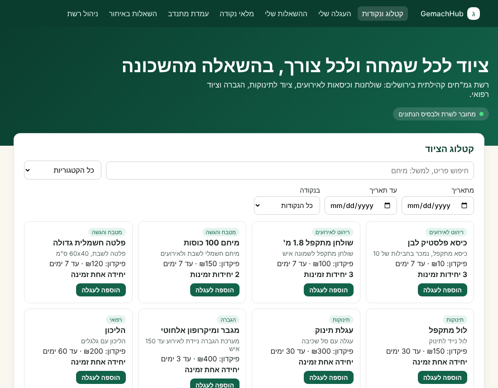

### 2. בדיקת זמינות בתאריכים ובנקודה
בשורה השנייה של הסינון בוחרים **מתאריך**, **עד תאריך** ו**נקודה**.
פריט שאין ממנו יחידה פנויה בתאריכים האלה מוצג באפור עם הכיתוב "לא זמין בתאריכים האלה", ואם ידוע מתי יתפנה, מופיע גם "יתפנה ב-" עם התאריך.

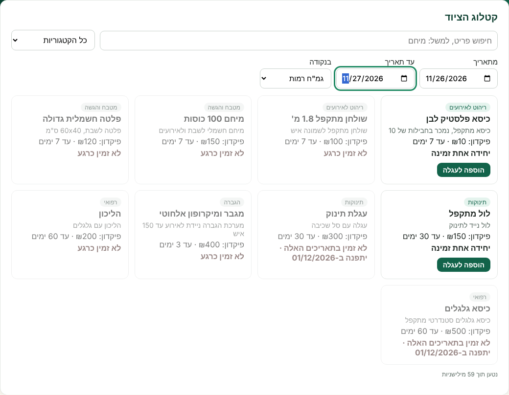

### 3. נקודות הגמ"ח במפה
בכרטיס "נקודות הגמ"ח" מופיעה מפה עם כל הנקודות הפעילות. לחיצה על נקודה (במפה או ברשימה) מציגה כתובת, שעות פעילות וקישורי ניווט ב-Google Maps וב-Waze.

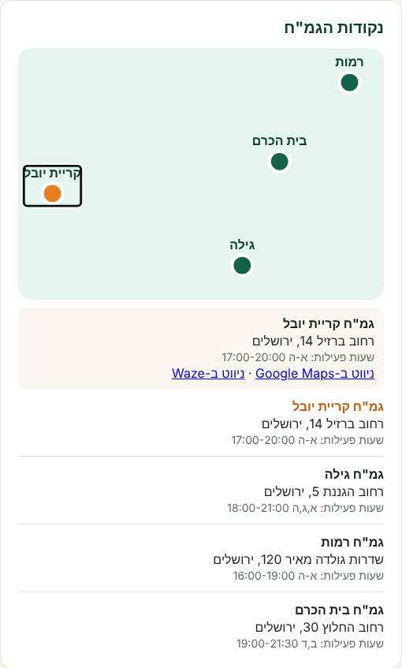

### 4. כרטיס פריט
לחיצה על שם פריט בקטלוג פותחת את כרטיס הפריט: גלריית תמונות (לחיצה על תמונה קטנה מחליפה את התמונה הגדולה), פיקדון, תקופת השאלה מקסימלית, וטבלת זמינות לפי נקודות.

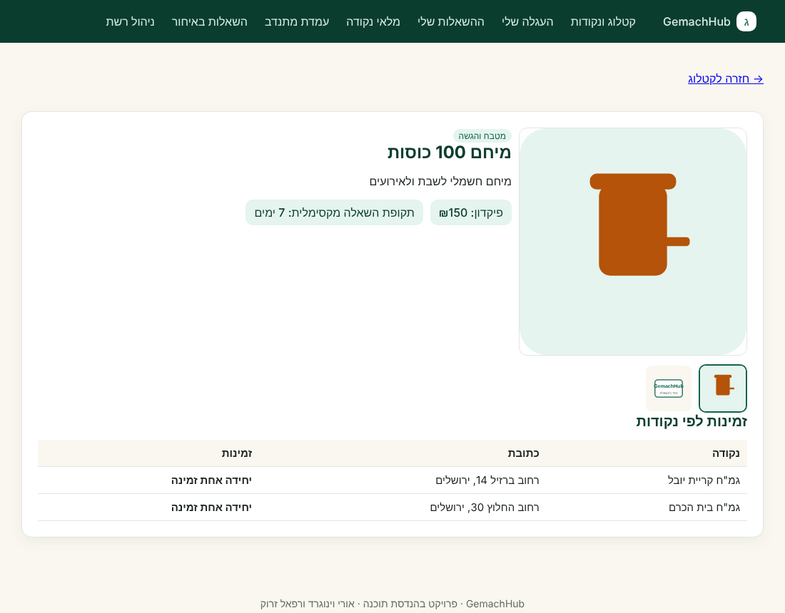

### 5. העגלה והזמנה
1. בקטלוג לוחצים **הוספה לעגלה** ליד הפריט.
2. בדף **העגלה שלי** מזינים את מספר הטלפון ולוחצים **כניסה**. העגלה נשמרת גם לכניסה הבאה.
3. אפשר לשנות כמות או ללחוץ **הסרה**. אי אפשר לבחור יותר יחידות ממה שזמין, וסך הפיקדון מתעדכן.
4. בכרטיס **פרטי ההזמנה** ממלאים שם, נקודת איסוף, תאריך איסוף, תאריך החזרה ושעת איסוף (השעות לפי שעות הפעילות של הנקודה).
5. לוחצים **שליחת ההזמנה**.

כללים שהמערכת בודקת: אין איסוף והחזרה בשבת ובחג, ומשך ההשאלה עד המקסימום של הפריטים שבעגלה. אם יש בעיה, מוצגת הודעה ברורה וההזמנה לא נשלחת.

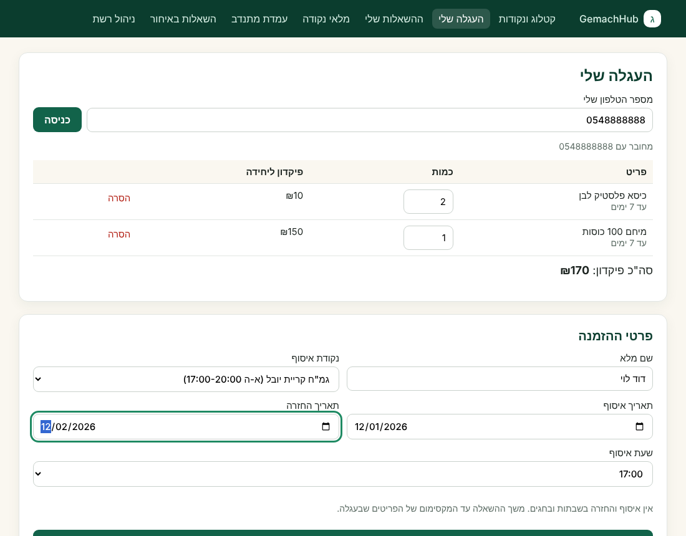

אחרי השליחה מוצג **מספר ההזמנה** (למשל GH-434265) ו**קוד QR** של ההזמנה. את הקוד מציגים למתנדב באיסוף. מספר ההזמנה נשלח גם בהודעה לטלפון, וההזמנה מופיעה בדף ההשאלות שלי יחד עם ה-QR.

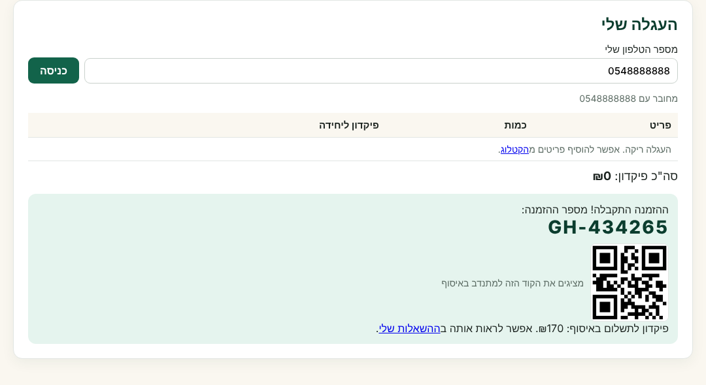

### 6. ההשאלות שלי
בדף **ההשאלות שלי** מזינים טלפון ולוחצים **הצגה**. מוצגות כל ההזמנות: פעילות והיסטוריה, עם הפריטים, מועד האיסוף, תאריך ההחזרה ופרטי הנקודה.
השאלה באיחור מסומנת באדום עם מספר ימי האיחור. להזמנה פעילה מוצג קוד QR לסריקה בנקודה.

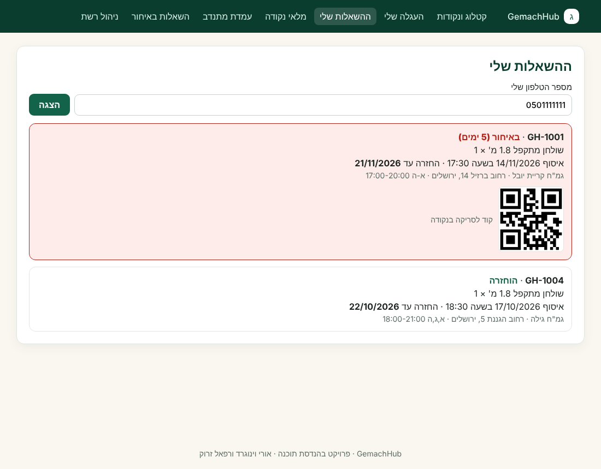

---

## חלק ב: תורמים

### 7. הצעת תרומה ומעקב
בדף הבית, בכרטיס **רוצים לתרום ציוד?**:
1. ממלאים שם, טלפון, מה רוצים לתרום, קטגוריה, נקודת מסירה ותיאור.
2. מצרפים **תמונה של הפריט** (חובה, עד 2MB). בלי תמונה ההצעה לא נשלחת.
3. לוחצים **שליחת הצעת תרומה**. מתקבל **מספר פנייה**, ונשלחת הודעה לטלפון.

ב**מעקב אחרי התרומות שלי** מזינים את הטלפון ולוחצים **הצגת התרומות שלי** כדי לראות את הסטטוס (ממתינה לאישור, אושרה, נדחתה, נקלטה בנקודה).

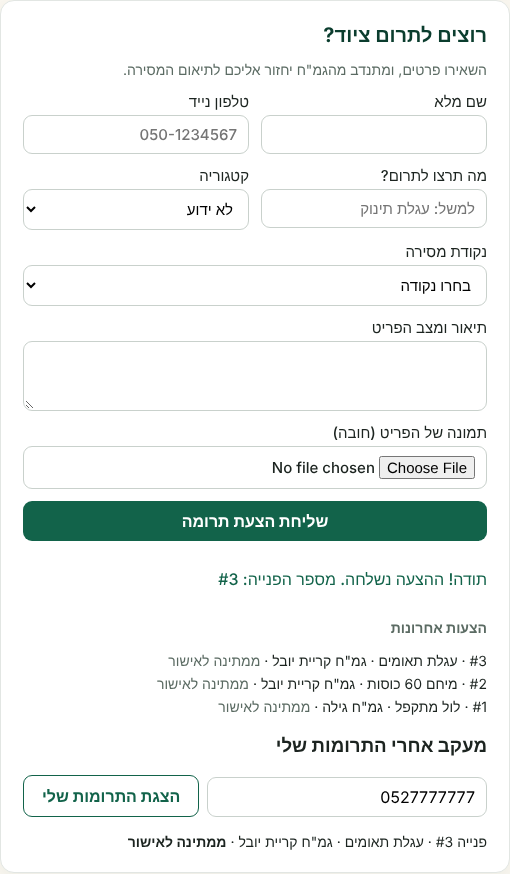

---

## חלק ג: מתנדבים בנקודה

### 8. מלאי הנקודה
בדף **מלאי נקודה** בוחרים נקודה. למעלה מוצגים מונים לפי סטטוס: זמין, מושאל, בתיקון, אבד. בטבלה מופיעה כל יחידה עם הקוד שלה, ואפשר לסנן לפי פריט.

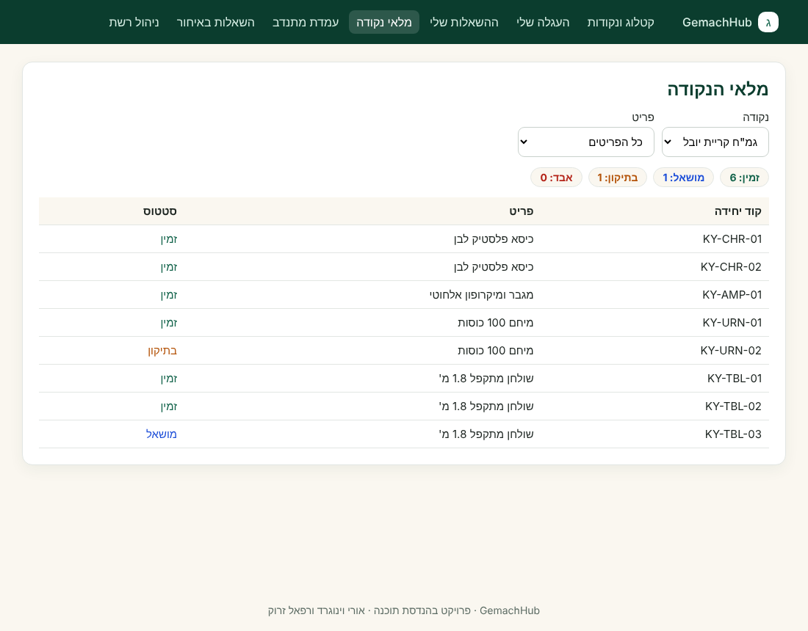

### 9. איסופים להיום ומסירה
בדף **עמדת מתנדב** בוחרים את **הנקודה שלי**.
- **איסופים להיום:** רשימת ההזמנות שנאספות היום, לפי שעה, עם השואל, הטלפון, הפריטים והסטטוס (ממתין או נאסף).

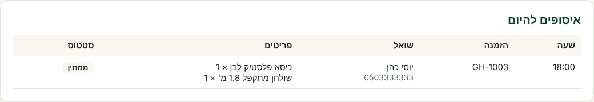

- **מסירת הזמנה:** מקלידים את מספר ההזמנה או את הטלפון של השואל ולוחצים **חיפוש**. בטלפון עם כרום אפשר ללחוץ **סריקת QR** ולסרוק את הקוד שהשואל מציג.
  מוצגים פרטי ההזמנה, היחידות שצריך למסור (לפי הקוד שלהן), ו"פיקדון בתוקף" בירוק. לוחצים **מסירת הציוד**.
  הזמנה של נקודה אחרת מציגה שגיאה ולא נמסרת.

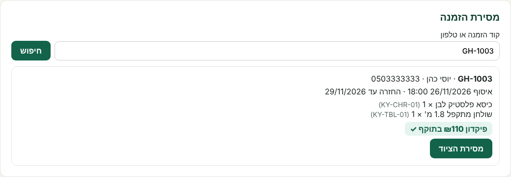

### 10. קליטת החזרה ותיעוד נזק
בכרטיס **קליטת החזרה** מקלידים את מספר ההזמנה ולוחצים **טעינת ההזמנה**.
1. סורקים או מקלידים את קוד היחידה בשדה **סריקת יחידה** ולוחצים **סימון** (או מסמנים את התיבה ליד היחידה).
2. לוחצים **קליטת היחידות שסומנו**. אפשר להחזיר רק חלק מהיחידות, והמערכת מציגה כמה נשארו.
3. כשכל הציוד חזר תקין, מסגרת הפיקדון משתחררת ונשלחת הודעה לשואל.

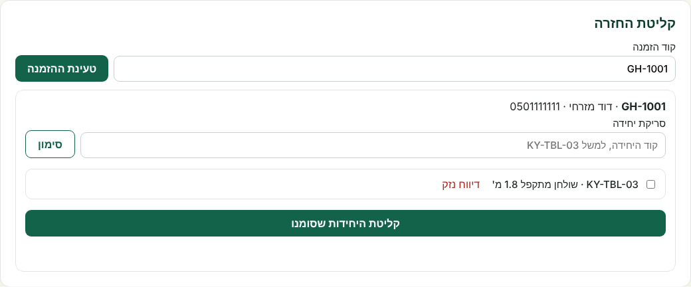

**נזק:** לוחצים **דיווח נזק** ליד היחידה, בוחרים דרגת חומרה (קל, בינוני, חמור), כותבים תיאור ומצרפים **תמונה של הנזק** (חובה). לוחצים **שמירת הנזק**.
היחידה עוברת לסטטוס "בתיקון", והפיקדון נשאר תפוס לבדיקה.

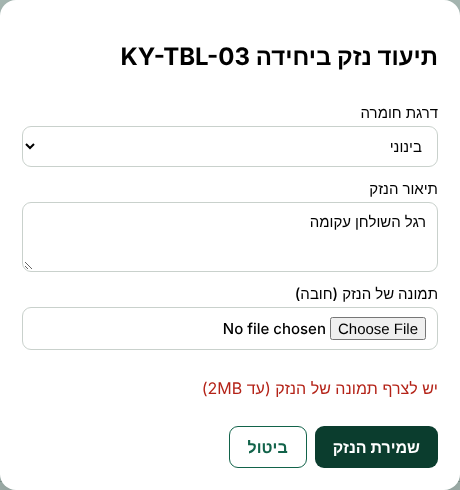

### 11. השאלות באיחור
בדף **השאלות באיחור** בוחרים נקודה. מוצגות ההשאלות שלא הוחזרו בזמן, מהאיחור הגדול לקטן, והטלפון של השואל הוא קישור לחיוג.

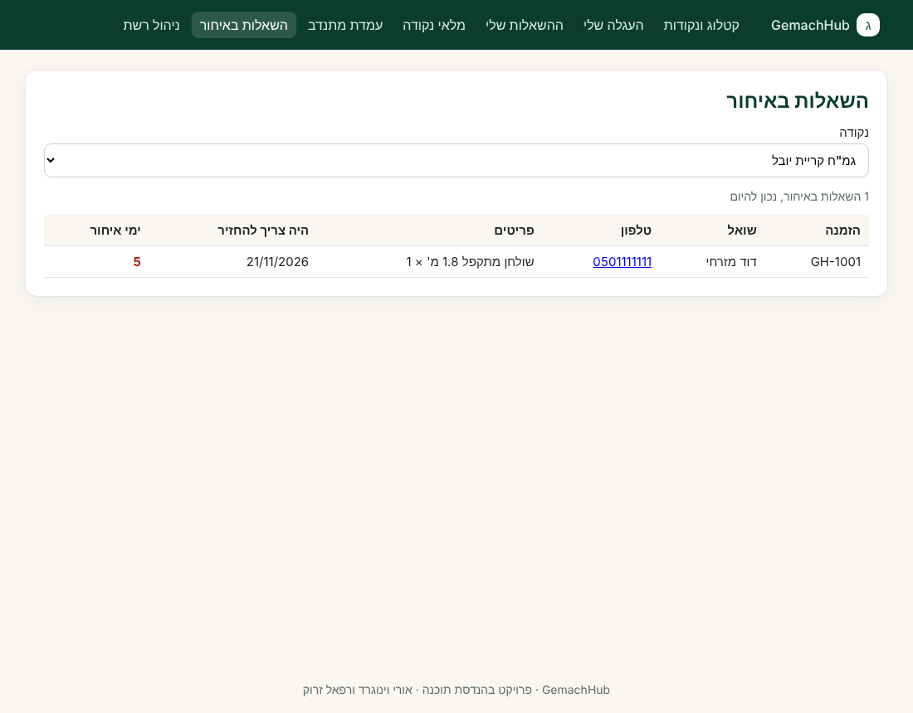

### 12. עבודה מהטלפון
כל הדפים מותאמים לטלפון. טבלה רחבה נגללת לרוחב בתוך הכרטיס שלה.

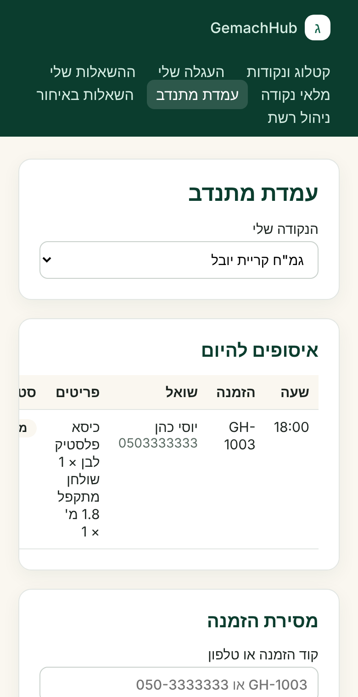

---

## חלק ד: מנהל רשת

### 13. לוח בקרה (KPI)
בדף **ניהול רשת** מוצג לוח בקרה: השאלות פעילות, השאלות באיחור, הזמנות שממתינות לאיסוף, השאלות ב-30 הימים האחרונים, יחידות זמינות, יחידות בתיקון, תרומות ממתינות וניצול הציוד.
אפשר לבחור נקודה כדי לראות את הנתונים שלה בלבד. הנתונים מחושבים פעם ביום ומוצג התאריך שלהם.

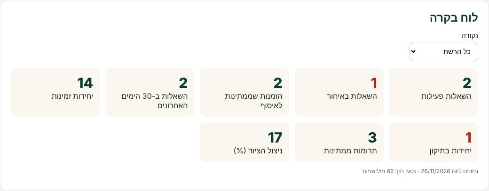

### 14. אישור ודחייה של תרומות
ב**תרומות ממתינות לאישור** מוצגת כל הצעה עם התמונה, התיאור ופרטי התורם.
- **אישור:** לוחצים **אישור**.
- **דחייה:** חובה לכתוב נימוק בשדה, ואז ללחוץ **דחייה**. בלי נימוק מוצגת הודעה "בדחייה חובה לכתוב נימוק".

בכל החלטה נשלחת הודעה לתורם (עם הנימוק בדחייה), והפעולה נרשמת בלוג הפעולות.

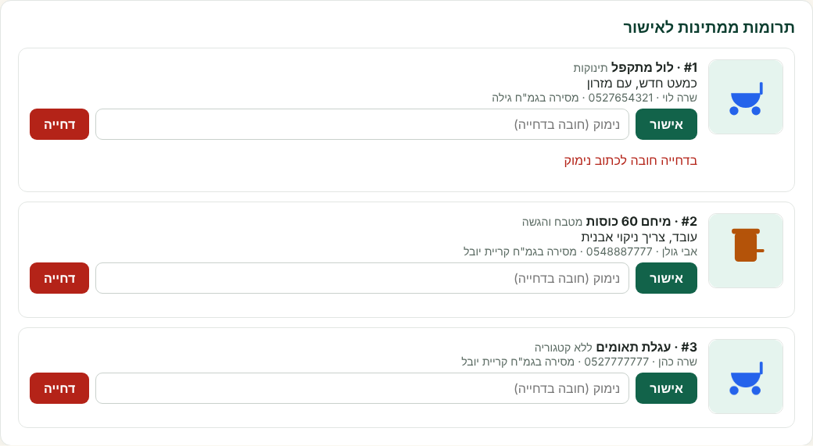

---

## בעיות נפוצות

| מה רואים | מה עושים |
|---|---|
| בראש דף הבית לא כתוב "מחובר לשרת ולבסיס הנתונים" | בודקים שהמערכת רצה (`docker compose up --build`) ושהקובץ `.env` מוגדר נכון (ראו README) |
| "אין איסוף בשבת" או "אין איסוף בחג" | בוחרים תאריך איסוף או החזרה ביום חול |
| "אפשר להזמין עד X" | אין מספיק יחידות פנויות. מקטינים את הכמות או בוחרים תאריכים אחרים |
| "ההזמנה שייכת לנקודה אחרת" | בוחרים את הנקודה הנכונה בראש עמדת המתנדב |
| כפתור "סריקת QR" לא מופיע | הדפדפן לא תומך בסריקה. מקלידים את מספר ההזמנה או את הטלפון |
